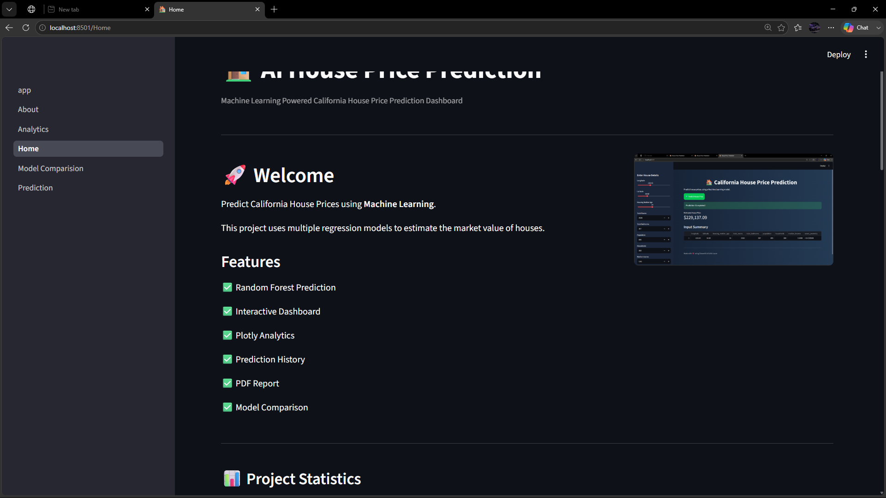
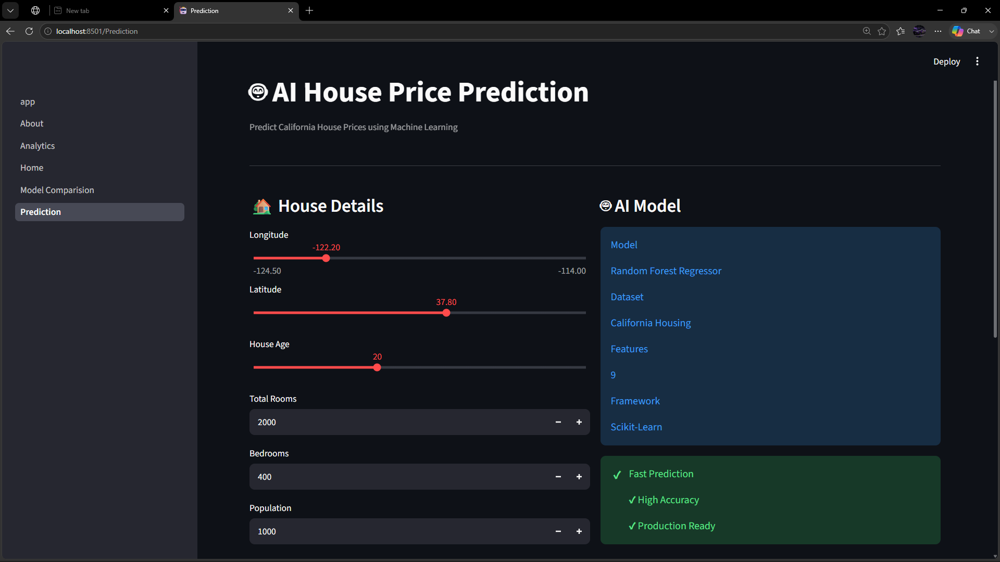
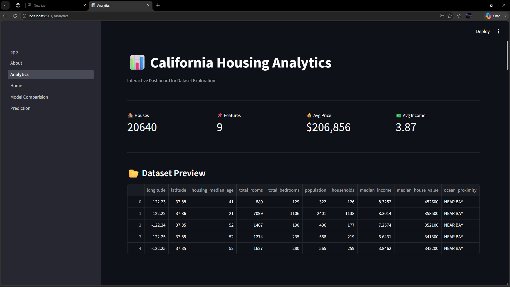
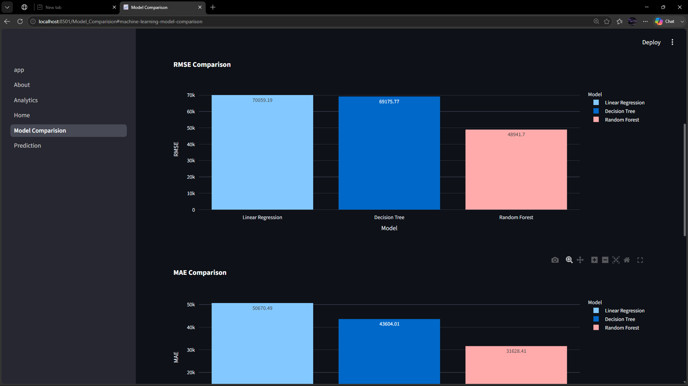
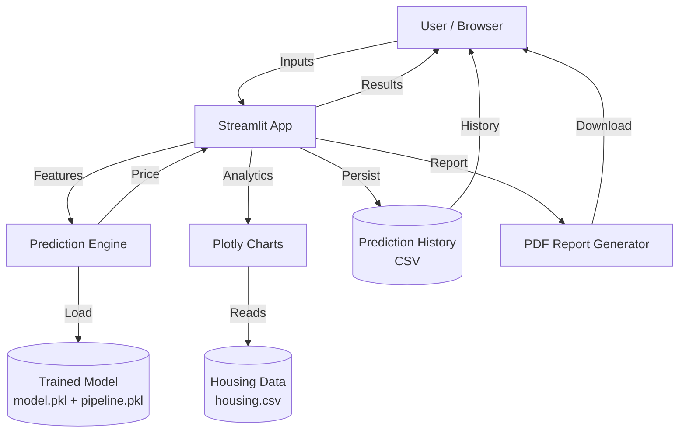
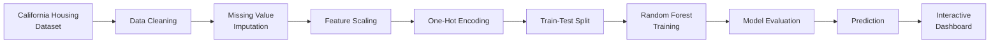

<div align="center">

# 🏠 AI House Price Prediction Dashboard

**An end-to-end Machine Learning web app that predicts California house prices and turns the data into an interactive analytics dashboard.**


</div>

---

## 📸 Dashboard Preview

| Home | Prediction |
|------|------------|
|  |  |

| Analytics | Model Comparison |
|-----------|------------------|
|  |  |

---

## ✨ Features that Empower You

### 🤖 AI-Powered Prediction
- Predict California house prices in real time
- Random Forest Regression model behind every result
- Clean interactive form with an instant prediction card

### 📊 Interactive Analytics
- House price and income distributions
- Population analysis and feature correlation matrix
- Fully interactive Plotly charts in a responsive layout

### 🏆 Model Comparison
Benchmark multiple algorithms side by side:

| Model | Metrics |
|-------|---------|
| Linear Regression | RMSE · MAE · R² |
| Decision Tree Regressor | RMSE · MAE · R² |
| Random Forest Regressor | RMSE · MAE · R² |

### 📄 Reports & History
- Automatic prediction history
- One-click CSV export
- PDF report generation

---

## 🏗️ System Architecture



### 🔄 Machine Learning Pipeline



---

## 🚀 Experience the Power

| Page | What you get |
|------|--------------|
| 🏠 **Home** | Project overview, KPI cards, dataset summary and tech stack |
| 🤖 **Prediction** | Interactive form, AI prediction card and CSV export |
| 📊 **Analytics** | Price and income distributions, correlation matrix, interactive charts |
| 📈 **Model Comparison** | RMSE, MAE and R² for all three models |
| ℹ️ **About** | Project details, developer info and future improvements |

### 🏠 Input Features

| Feature | Description |
|---------|-------------|
| Longitude | Geographic longitude |
| Latitude | Geographic latitude |
| Housing Median Age | Average age of houses |
| Total Rooms | Number of rooms |
| Total Bedrooms | Number of bedrooms |
| Population | Area population |
| Households | Number of households |
| Median Income | Median household income |
| Ocean Proximity | Location category |

---

## 🛠 Tech Stack

| Layer | Technologies |
|-------|--------------|
| **Language** | Python |
| **Machine Learning** | Scikit-learn, Random Forest, Decision Tree, Linear Regression |
| **Data Processing** | Pandas, NumPy |
| **Visualization** | Plotly, Matplotlib |
| **Frontend** | Streamlit |
| **Model Storage** | Joblib |

---

## 📂 Project Structure

```text
House-Price-Prediction/
│
├── app.py                    # Main Streamlit application
├── train.py                  # Model training
├── predict.py                # Prediction logic
├── requirements.txt
├── README.md
│
├── pages/
│   ├── 1_🏠_Home.py
│   ├── 2_🤖_Prediction.py
│   ├── 3_📊_Analytics.py
│   ├── 4_📈_Model_Comparison.py
│   └── 5_ℹ️_About.py
│
├── utils/
│   ├── charts.py
│   ├── pdf_generator.py
│   ├── history.py
│   └── styles.py
│
├── models/
│   ├── model.pkl
│   └── pipeline.pkl
│
├── data/
│   ├── housing.csv
│   ├── input.csv
│   ├── output.csv
│   └── prediction_history.csv
│
├── assets/                   # Logo, CSS and screenshots
│
└── reports/
    ├── prediction.csv
    └── prediction_report.pdf
```

---

## ⚙️ Installation

### 1️⃣ Clone the repository

```bash
git clone https://github.com/ARHAM56/House-Price-Prediction.git
cd House-Price-Prediction
```

### 2️⃣ Create a virtual environment

**Windows**
```bash
python -m venv venv
venv\Scripts\activate
```

**Linux / macOS**
```bash
python3 -m venv venv
source venv/bin/activate
```

### 3️⃣ Install dependencies

```bash
pip install -r requirements.txt
```

### 4️⃣ Train the model

```bash
python train.py
```

This generates `model.pkl` and `pipeline.pkl` inside the `models/` folder.

### 5️⃣ Run the app

```bash
streamlit run app.py
```

Then open **http://localhost:8501** in your browser.

---

## 🌟 Future Improvements

- [ ] SHAP Explainable AI
- [ ] XGBoost, LightGBM and CatBoost
- [ ] Deep Learning models
- [ ] Prediction confidence intervals
- [ ] Interactive maps
- [ ] User authentication
- [ ] REST API
- [ ] Docker support
- [ ] Streamlit Cloud deployment
- [ ] CI/CD pipeline
- [ ] Database integration
- [ ] Real-time data

---

## 👨‍💻 Developer

**Arham Aziz** — B.Tech, Artificial Intelligence & Machine Learning Engineering

**Skills:** Python · Java · Spring Boot · SQL · Machine Learning · Data Analytics · Streamlit

[](https://github.com/ARHAM56)
[](https://www.linkedin.com/in/arham-aziz-aa48ba41b/)

---

## 📜 License

This project is developed for educational and portfolio purposes.

## ⭐ Support

If you found this project helpful, please **star the repository** on GitHub. It motivates me to build more AI & Machine Learning projects.

<div align="center">

**Made with ❤️ using Python, Streamlit, Scikit-learn & Plotly**

</div>
