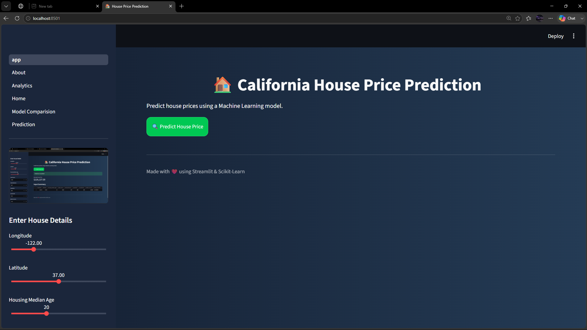
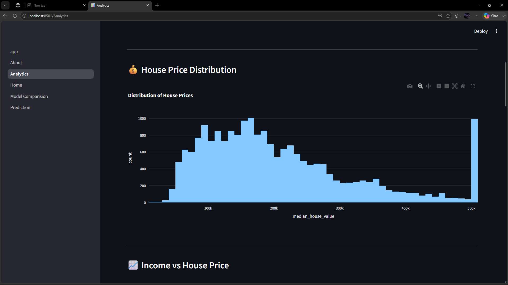
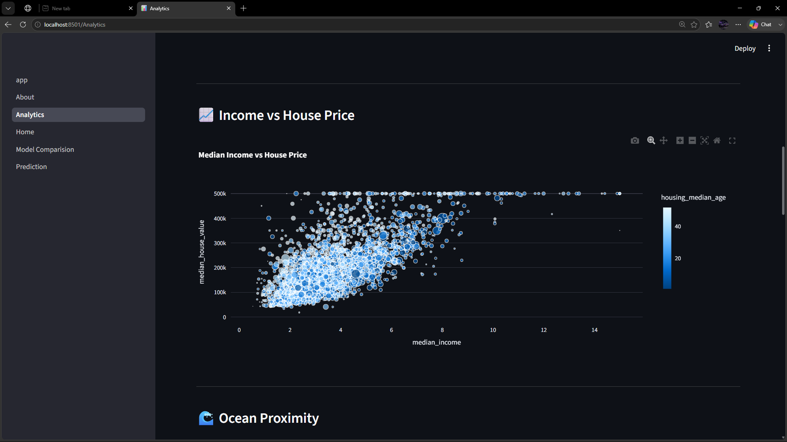
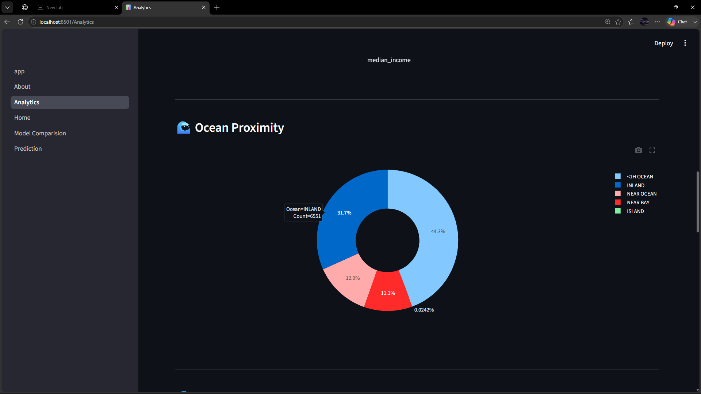
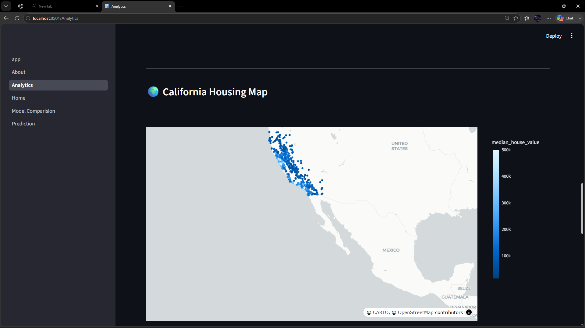
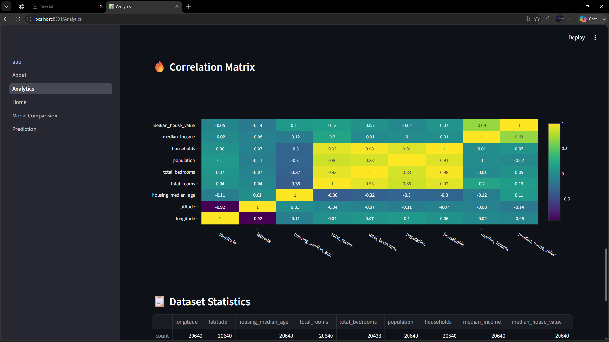
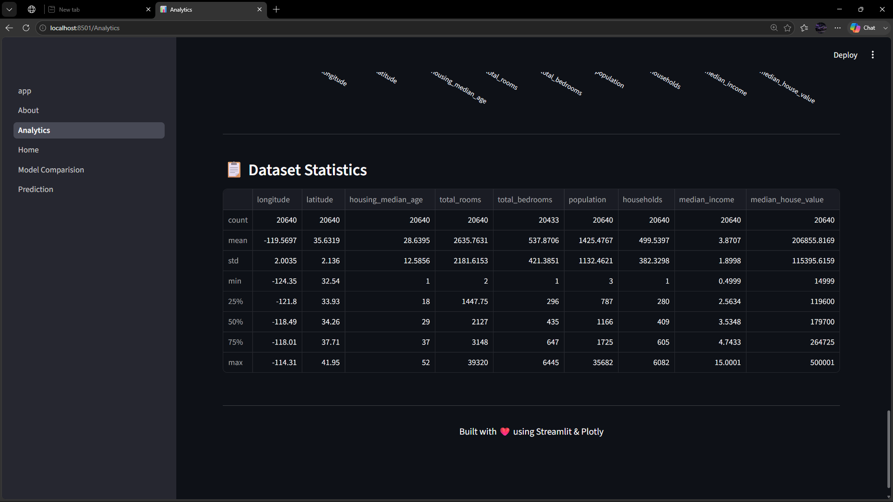
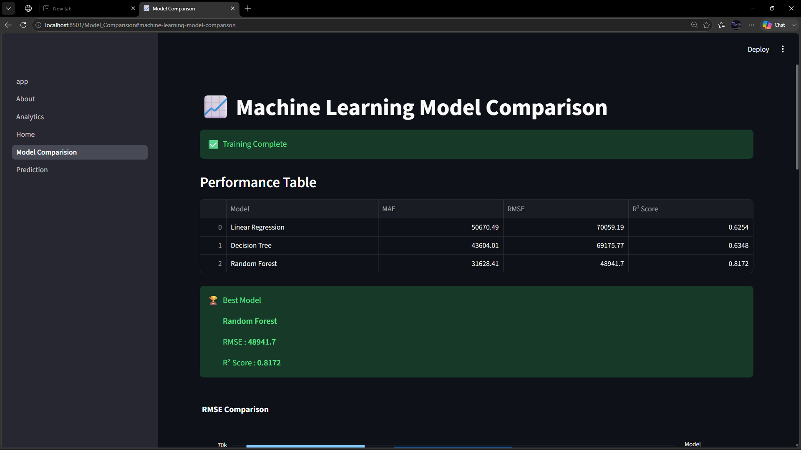
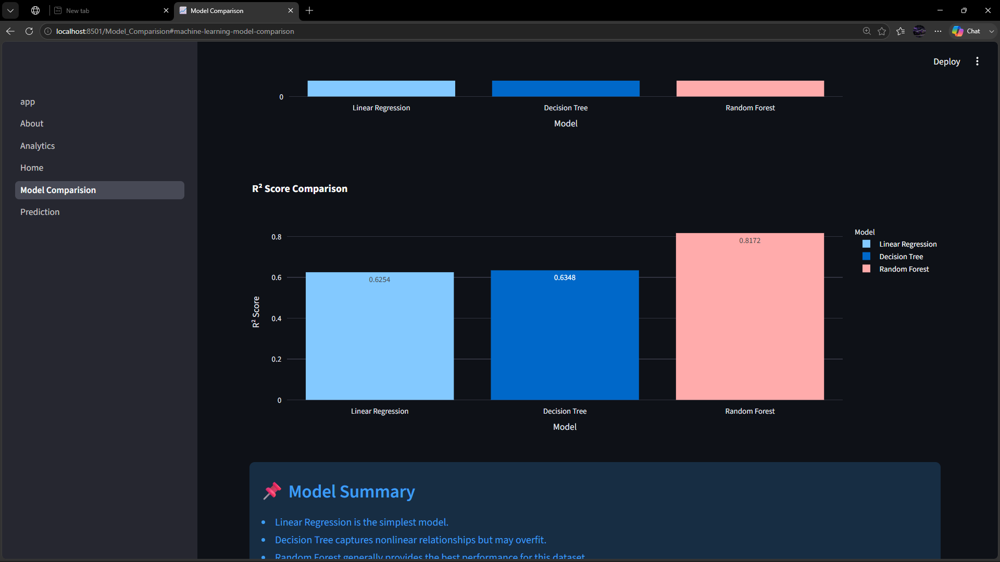
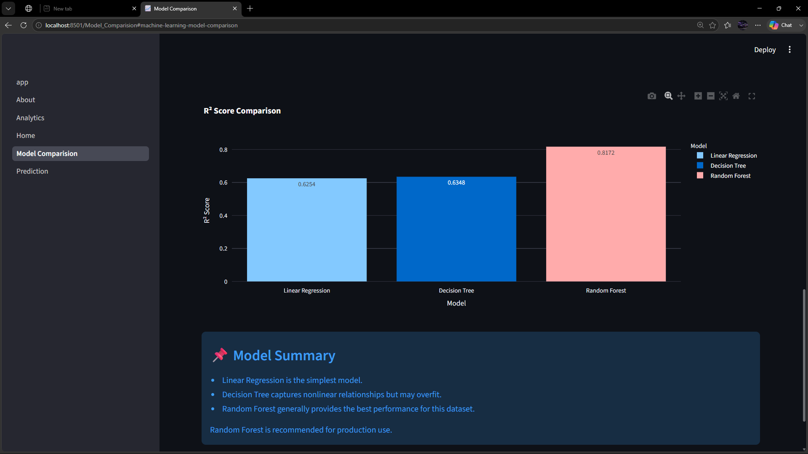

# 🏠 AI House Price Prediction Dashboard

An end-to-end **Machine Learning** web application built using **Python, Scikit-learn, Streamlit, and Plotly** to predict California house prices with an interactive analytics dashboard.

---

# 📸 Dashboard Preview

> Replace the images below after taking screenshots of your application.

| Home | Prediction |
|------|------------|
|  |  |

| Analytics | Model Comparison |
|------------|------------------|
|  |  |

---

# 🚀 Features

## 🤖 AI Prediction

- Predict California House Prices
- Random Forest Regression Model
- Real-time Predictions
- Confidence-based Results

## 📊 Interactive Dashboard

- Modern Streamlit UI
- Interactive Plotly Charts
- Analytics Dashboard
- Responsive Layout

## 📈 Data Analytics

- House Price Distribution
- Income Analysis
- Population Analysis
- Feature Correlation
- Data Visualization

## 🏆 Model Comparison

Compare multiple Machine Learning algorithms:

- ✅ Linear Regression
- ✅ Decision Tree Regressor
- ✅ Random Forest Regressor

Performance Metrics:

- RMSE
- MAE
- R² Score

## 📄 Reports

- Prediction History
- CSV Export
- PDF Report Generation

---

# 🛠️ Technology Stack

### Programming

- Python

### Machine Learning

- Scikit-learn
- Random Forest
- Decision Tree
- Linear Regression

### Data Processing

- Pandas
- NumPy

### Visualization

- Plotly
- Matplotlib

### Frontend

- Streamlit

### Model Storage

- Joblib

---

# 📂 Project Structure

```text
House-Price-Prediction/
│
├── app.py                    # Main Streamlit Application
├── train.py                  # Model Training
├── predict.py                # Prediction Logic
├── requirements.txt
├── README.md
│
├── pages/
│   ├── 1_🏠_Home.py
│   ├── 2_🤖_Prediction.py
│   ├── 3_📊_Analytics.py
│   ├── 4_📈_Model_Comparison.py
│   └── 5_ℹ️_About.py
│
├── utils/
│   ├── charts.py
│   ├── pdf_generator.py
│   ├── history.py
│   └── styles.py
│
├── models/
│   ├── model.pkl
│   └── pipeline.pkl
│
├── data/
│   ├── housing.csv
│   ├── input.csv
│   ├── output.csv
│   └── prediction_history.csv
│
├── assets/
│   ├── logo.png
│   ├── style.css
│   ├── home.png
│   ├── prediction.png
│   ├── analytics.png
│   └── model.png
│
└── reports/
    ├── prediction.csv
    └── prediction_report.pdf
```

---

# ⚙️ Installation

## 1️⃣ Clone Repository

```bash
git clone https://github.com/ARHAM56/House-Price-Prediction.git
```

---

## 2️⃣ Open Project

```bash
cd House-Price-Prediction
```

---

## 3️⃣ Create Virtual Environment

### Windows

```bash
python -m venv venv
```

Activate

```bash
venv\Scripts\activate
```

### Linux / macOS

```bash
python3 -m venv venv
source venv/bin/activate
```

---

## 4️⃣ Install Dependencies

```bash
pip install -r requirements.txt
```

---

## 5️⃣ Train the Machine Learning Model

```bash
python train.py
```

This generates:

- model.pkl
- pipeline.pkl

inside the **models/** directory.

---

## 6️⃣ Run the Application

```bash
streamlit run app.py
```

Open your browser and visit

```
http://localhost:8501
```

---

# 🏠 Input Features

The prediction model uses the following features:

| Feature | Description |
|----------|-------------|
| Longitude | Geographic Longitude |
| Latitude | Geographic Latitude |
| Housing Median Age | Average Age of Houses |
| Total Rooms | Number of Rooms |
| Total Bedrooms | Number of Bedrooms |
| Population | Area Population |
| Households | Number of Households |
| Median Income | Median Household Income |
| Ocean Proximity | Location Category |

---

# 🤖 Machine Learning Pipeline

```
California Housing Dataset
            │
            ▼
Data Cleaning
            │
            ▼
Missing Value Imputation
            │
            ▼
Feature Scaling
            │
            ▼
One-Hot Encoding
            │
            ▼
Train-Test Split
            │
            ▼
Random Forest Training
            │
            ▼
Model Evaluation
            │
            ▼
Prediction
            │
            ▼
Interactive Dashboard
```

---

# 📈 Dashboard Pages

## 🏠 Home

- Project Overview
- KPI Cards
- Dataset Summary
- Technology Stack

---

## 🤖 Prediction

- House Price Prediction
- Interactive Form
- AI Prediction Card
- CSV Export

---

## 📊 Analytics

- Price Distribution
- Income Distribution
- Correlation Matrix
- Interactive Charts

---

## 📈 Model Comparison

Compare

- Linear Regression
- Decision Tree
- Random Forest

Evaluation Metrics

- RMSE
- MAE
- R² Score

---

## ℹ️ About

- Project Details
- Developer Information
- Technologies Used
- Future Improvements

---

# 📦 Python Libraries

```
streamlit
pandas
numpy
scikit-learn
plotly
matplotlib
joblib
```

---

# 📸 Screenshots

## 🏠 Home




---

## 🤖 Prediction


---

## 📊 Analytics










---

## 📈 Model Comparison







---

# 🌟 Future Improvements

- SHAP Explainable AI
- XGBoost
- LightGBM
- CatBoost
- Deep Learning Models
- Prediction Confidence
- Interactive Maps
- User Authentication
- Docker Support
- REST API
- Streamlit Cloud Deployment
- CI/CD Pipeline
- Database Integration
- Real-Time Data

---

# 👨‍💻 Developer

## **Arham Aziz**

**B.Tech Artificial Intelligence & Machine Learning Engineering**

### Skills

- Python
- Java
- Spring Boot
- SQL
- Machine Learning
- Data Analytics
- Streamlit

### GitHub

https://github.com/ARHAM56

### LinkedIn

https://www.linkedin.com/in/arham-aziz-aa48ba41b/

---

# 📜 License

This project is developed for educational and portfolio purposes.

---

# ⭐ Support

If you found this project helpful,

⭐ **Star this repository on GitHub**

It motivates me to build more AI & Machine Learning projects.

---

## 💙 Thank You

**Made with ❤️ using Python, Streamlit, Scikit-learn, Plotly & Machine Learning**